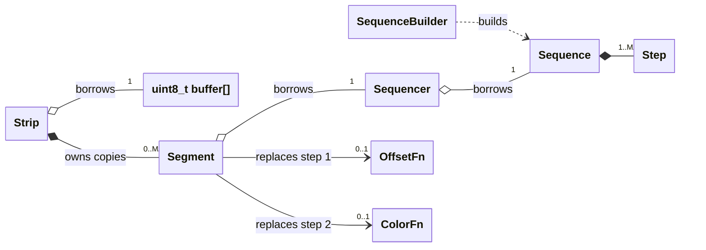
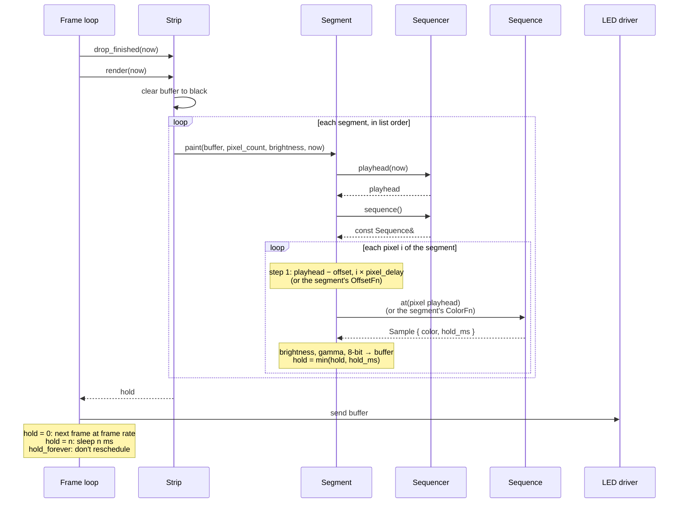

# StripSequencer — cookbook

The library in use. [DESIGN.md](DESIGN.md) explains the mechanism and why it is shaped the way it is; this document shows how it is called — how the pieces relate, what one frame does, how a sequencer is driven — and then DESIGN.md's cookbook written out as real code, along with its overlap example.

The recipes are not illustrations that might have drifted. [`tests/cookbook.cpp`](../tests/cookbook.cpp) compiles every one of them verbatim and checks each against property assertions and a golden-frame hash in every build variant, and a CTest entry fails when a code block under [the recipes](#the-recipes) no longer appears there. The declarations themselves, with the reasoning behind each, are in [`include/stripseq/`](../include/stripseq/).

## Contents

- [How the pieces fit](#how-the-pieces-fit)
- [One frame](#one-frame)
- [Driving a sequencer](#driving-a-sequencer)
- [The recipes](#the-recipes)
- [On Zephyr](#on-zephyr)

## How the pieces fit

DESIGN.md's [four building blocks](DESIGN.md#the-four-building-blocks), and the two ways your code calls into them.

### Who owns what



- **A segment is copied; everything else is borrowed.** A `Segment` built locally is copied by `add()`, so changing the local one afterwards changes nothing on the strip; the strip's copy is reached through `strip.segment(i)`. A segment is small and fixed in size, and copying it is what lets `add()` take one built on the spot.
- **What is borrowed belongs to your code.** The buffer, every sequencer a segment points at, and every sequence a sequencer has loaded must outlive whatever points at them. Static storage, which the cookbook uses throughout, satisfies all three: a `static constexpr Sequence` is constant-initialised into flash and costs no RAM at all.
- **A sequence is borrowed rather than copied because of what a copy costs.** A `Sequence` is allocated at full step capacity, about 116 bytes at the default, and most sequences are known at compile time and already sit whole in flash; a copy per sequencer would put a second one in RAM to gain nothing. Borrowing has two consequences. A temporary cannot be loaded, since it would dangle by the end of the statement, so `load()` has a deleted rvalue overload and the mistake is a compile error. And a sequence rebuilt with `build()` while it is loaded shows on the next render, with the playhead left where it was; `load()` again to start from the top.
- **Many segments may point at one sequencer**, which is how two parts of a strip run in lockstep. Nothing points the other way: a sequencer does not know which segments read it.
- **`OffsetFn` and `ColorFn` are plain function pointers**, held by the segment and null unless installed. Null means the default for that step.

### Two kinds of call

Every call into the library is one of two kinds, and keeping them apart is most of what there is to understanding the API.

- **Control calls** say what the strip should show: `load`, `play`, `pause` and `seek` on a sequencer, the setters on a segment, and `add`, `remove`, `clear`, `segment(i) = …` and `set_brightness` on the strip. They are made when something in the application changes — at start-up, when an alert fires, when a progress value moves. None of them touches the buffer, and none of them sets anything running: `play()` stores one number and returns.
- **The frame call** is `render(now)`. It works out what every pixel looks like at `now`, writes the buffer, and returns how long until anything changes. Calling it twice with the same `now` produces the same buffer.

`drop_finished(now)` sits between the two: it is a control call, but in an application whose overlays come and go, the frame loop is where it usually gets made, just before `render`. It removes every finished segment, including one that is meant to stay on its landing color, so a strip running the [Wipe](#the-recipes) leaves it out.

Between one `render()` and the next, the library does not run at all. There is no timer, no thread and no callback, which is how `play()` can amount to storing a number: the playhead moves only in the sense that the next `render()` asks with a later `now`.

Two things follow for the code around it. A control call changes the picture without the clock moving, so the previous `render()`'s hold no longer applies: render again rather than waiting it out, which means a frame loop that sleeps on the hold needs a way to be woken. And the library has no locks, so no two calls may overlap: a control call made from an interrupt or another thread while `render()` is running can be seen half-made. Make every call from the context the frame loop runs in, and have an interrupt hand its change over to that context rather than calling in itself.

## One frame

All four at work through one call to `render()`.



Everything from `paint` down happens within `render()`; `paint` is private and only the strip calls it, and the rest are public calls the segment makes. The two notes on the pixel loop are the two [plug-in points](DESIGN.md#two-places-to-plug-in), shown with their defaults. The sequencer is asked once per segment rather than once per pixel: every pixel in a segment starts from the same playhead and differs only by step 1.

The segment asks the sequencer for two things, a playhead and the sequence it owns, and then calls `at()` on that sequence itself, once per pixel. It cannot ask the sequencer for a color instead, because the sequencer knows only the unstaggered playhead, and each pixel's playhead differs from it by step 1, which only the segment can compute. A `Sequencer::at()` that forwarded the pixel's playhead would add a hop and decide nothing; the sequencer's job ends at turning a clock reading into a playhead.

## Driving a sequencer

A sequencer has four control calls, `load`, `play`, `pause` and `seek`, and one bit of state: whether the playhead follows the clock. This is what each call does to it, and what the playhead then reads.

### Play, pause and seek

Underneath the playhead is a *position*, the number of milliseconds into the sequence, which is answered one of two ways. While playing, the position follows the clock: the sequencer keeps `origin_ms_`, the clock reading at which the position was 0, and answers `now - origin_ms_`. Otherwise it keeps the position itself in `frozen_` and answers that, whatever `now` is. The calls switch between the two without letting the value jump:

| Call | Stores | Effect |
| --- | --- | --- |
| `load(s)` | `frozen_ = 0`, `playing_ = false` | The position sits at the start of the new sequence. |
| `play(now)` | `origin_ms_ = now - frozen_`, `playing_ = true` | Picks the origin that puts the position at `frozen_` at this instant, so it carries on from where it stood. Nothing, if already playing. |
| `pause(now)` | `frozen_ = position(now)`, `playing_ = false` | Records where the position is at this instant, exactly, and keeps it there. Nothing, if not playing. |
| `seek(p)` | `frozen_ = p`, `playing_ = false` | Sets the value directly. Nothing is following the clock, so no `now` is needed. |

`play` and `pause` take `now` because each converts between a value and an origin on the clock; `seek` only ever sets a value. Each conversion reads the field the *other* state keeps current, which is why calling one in the state it would produce does nothing: `play` while playing would rebuild the origin from a `frozen_` left over from the last pause, and the playhead would jump back to it. Worked through, with clock time on the left:

```text
t=1000  load(s)       frozen = 0                    playhead(1000) = 0
t=1000  play(1000)    origin = 1000 - 0    = 1000   playhead(1300) = 300
t=1500  pause(1500)   frozen = 1500 - 1000 = 500    playhead(9999) = 500    stays put
t=4000  play(4000)    origin = 4000 - 500  = 3500   playhead(4200) = 700    carries on from 500
t=5000  seek(2000)    frozen = 2000                 playhead(5000) = 2000   not playing
t=6000  play(6000)    origin = 6000 - 2000 = 4000   playhead(6100) = 2100
```

The 2.5 s pause cost nothing: `play(4000)` put the origin 500 ms in the past, so the position resumed at exactly the value `pause` recorded. `pause` stores the position rather than the narrowed playhead, so the round trip is exact by construction, and neither call needs to know about range.

### What the playhead reads

`playhead(now)` is the position, narrowed so that any stagger a segment accepts can be added to it or taken from it inside `int32_t`. The narrowing is exact through `Sequence::at()`, so no pixel can tell it from the position itself.

An endless sequence's playhead is its position modulo the loop, since `at()` wraps by the loop length anyway:

```text
loop = 500 ms, play(1000)
now = 2730   position 1730   returns 230
now = 2746   position 1746   returns 246
now = 3010   position 2010   returns  10
```

So `seek(5000)` on a 1000 ms loop reads back 0: an endless sequence has no "5000 ms in" distinct from "0 ms in", and neither does anything that reads from it. A finite sequence's playhead is its position clamped to 2^30 ms, about 12.4 days, either side of zero — far enough past the end that every pixel has landed, and far enough before the start that every pixel shows the start color. A seeked position reads back exactly anywhere inside that range, so a paused progress bar reads back what it set.

### The clock

The clock is `int64_t` milliseconds, so the position never needs protecting. A difference of two such readings overflows after about 292 million years. The library therefore has no wrap to survive, no origin to move and nothing that must be called often enough to keep a value in range; `playhead()` is `const` because it only reads. The wrap of a narrower counter is real, but it belongs to whoever owns that counter. Under Zephyr the question never arises, since `k_uptime_get()` is already 64-bit. A bare-metal caller with only a 32-bit tick extends it once, in application code:

```cpp
/* Application code: call at least once per 49.7 days. */
struct Clock64 {
    uint32_t last = 0;
    int64_t  total = 0;
    int64_t operator()(uint32_t now) {
        total += static_cast<uint32_t>(now - last);   /* the wrap cancels here */
        last = now;
        return total;
    }
};
```

What the library does guard is the one way to get this wrong without noticing. A `uint32_t` passed where an `int64_t` is wanted converts silently — `-Wconversion` stays quiet, because no value is lost — and the wrap survives the conversion as a jump of 2^32 ms backwards, a finite sequence back to its start color after 49.7 days. So every function that takes `now_ms` has a deleted overload for any unsigned type of 32 bits or fewer, and `seq.play(k_uptime_get_32())` fails to compile rather than failing after seven weeks. A literal such as `play(1000)` is an `int`, which the deleted overload never matches, so it still compiles.

## The recipes

Setup is shown once and applies to every recipe below.

```cpp
using namespace stripseq;

static constexpr uint16_t kPixels = 30;

static uint8_t   buffer[kPixels * Strip::bytes_per_pixel];
static Sequencer seq;

constinit static Strip strip(buffer);   // pixel count deduced from the buffer;
                                        // segment capacity from STRIPSEQ_MAX_SEGMENTS
```

Every recipe names its sequence at namespace scope, because a sequencer refers to what it loads and the sequence has to outlive the call. `build_const()` makes each definition a constant expression, so the sequence is constant-initialised into flash like the `colors::` palette, nothing runs before `main`, no RAM is spent on it, and a malformed one fails to compile at the definition rather than at its use. The rainbow below is `inline constexpr` rather than `static constexpr` because two recipes share it, and a shared constant belongs in a header, where `inline` makes it one object at one address in every file that includes it. Not a `static constexpr` local inside the function that loads it: that would be constant-initialised too, but it looks exactly like a function-local static with a dynamic initialiser, which costs a guard and a lock.

**Blink** — the whole strip flashing together.

```cpp
static constexpr Sequence kBlink =
    SequenceBuilder{}.hold(colors::red, 500).hold(colors::black, 500).build_const();

seq.load(kBlink);
seq.play(now());
strip.add(Segment(0, kPixels, seq));      // pixel_delay defaults to 0
```

Say what the animation is, then load it, start it and give it some pixels — and the last of those is only there because a segment has to exist. Nothing in the common case asks for more than that.

**Breathe** — same shape, eased fades instead of holds.

```cpp
static constexpr Sequence kBreathe = SequenceBuilder{}
    .fade_to(colors::rgbwhite, 1000, Transition::EaseInOut)
    .fade_to(colors::black,    1000, Transition::EaseInOut)
    .build_const();

seq.load(kBreathe);
seq.play(now());
strip.add(Segment(0, kPixels, seq));
```

**Comet** — a bright head with a fading tail, running down the strip.

```cpp
static constexpr Sequence kComet = SequenceBuilder{}
    .hold(colors::rgbwhite, 50)
    .fade_to(colors::black, 450)
    .build_const();

seq.load(kComet);
seq.play(now());

Segment s(0, kPixels, seq);
s.set_pixel_delay(16);        // speed intent: 16 ms per pixel whatever the length
strip.add(s);
```

**Rainbow cycle** — six steps around the hue wheel, spread across the strip and rotating.

```cpp
inline constexpr Sequence kRainbow = SequenceBuilder{}
    .fade_to(Color::hsv(0x2AAA, 255, 255), 500)   // red   -> yellow
    .fade_to(Color::hsv(0x5555, 255, 255), 500)   //       -> green
    .fade_to(Color::hsv(0x8000, 255, 255), 500)   //       -> cyan
    .fade_to(Color::hsv(0xAAAA, 255, 255), 500)   //       -> blue
    .fade_to(Color::hsv(0xD555, 255, 255), 500)   //       -> magenta
    .fade_to(Color::hsv(0x0000, 255, 255), 500)   //       -> red
    .build_const();

seq.load(kRainbow);
seq.play(now());

Segment s(0, kPixels, seq);
s.set_pixel_delay_q8(spread(3000, kPixels));   // the whole wheel across the segment
strip.add(s);
```

**Static gradient** — the identical setup, never started.

```cpp
seq.load(kRainbow);
seq.seek(0);                  // seeked, never played: the playhead does not move

Segment s(0, kPixels, seq);
s.set_pixel_delay_q8(spread(3000, kPixels));
strip.add(s);
```

**Wipe** — green sweeping down a dark strip and staying.

```cpp
static constexpr Sequence kWipe = SequenceBuilder{}
    .start_color(colors::black)
    .fade_to(colors::green, 200)
    .landing_color(colors::green)
    .repeat(1)
    .build_const();

seq.load(kWipe);
seq.play(now());

Segment s(0, kPixels, seq);
s.set_pixel_delay(30);
strip.add(s);
```

The segment is deliberately left in place after it finishes: `landing_color` is what keeps the strip green. A frame loop that calls `drop_finished()` would blank it, so one running the Wipe leaves that call out.

**Progress bar** — a sequencer that never runs, whose playhead is the value.

```cpp
static constexpr Sequence kProgress = SequenceBuilder{}
    .start_color(colors::black)
    .fade_to(colors::red, 10)
    .landing_color(colors::red)
    .repeat(1)
    .build_const();

seq.load(kProgress);

Segment s(0, kPixels, seq);
s.set_pixel_delay(10);
strip.add(s);

// Called whenever the value changes.
void set_progress(uint8_t percent) {
    seq.seek(static_cast<int32_t>(percent) * kPixels * 10 / 100);
}
```

Why the edge comes out smooth is in [DESIGN.md's cookbook](DESIGN.md#cookbook).

**Two halves, different animations** — two segments, two sequencers.

```cpp
static Sequencer seq_a, seq_b;   // loaded and started as above

strip.add(Segment(0,  15, seq_a));
strip.add(Segment(15, 15, seq_b));
```

**Two halves, converging** — two segments, one sequencer, opposite delays, so both halves flow toward the centre.

```cpp
Segment left(0, 15, seq);
Segment right(15, 15, seq);
left.set_pixel_delay(20);
right.set_pixel_delay(-20);
strip.add(left);
strip.add(right);
```

Here the two pixels k from the centre are 14 × 20 = 280 ms apart, which is why [the picture is not a reflection](DESIGN.md#cookbook). A mirror is an `OffsetFn` on the right half returning `((count - 1 - index) * delay_q8) >> 8`, with both halves set to a delay of 20.

**Twinkle** — every pixel flashing at its own moment, through a replaced step 1.

```cpp
// pixel_delay is the span the offsets scatter across, here 1980 ms.
static int32_t scatter(uint16_t index, uint16_t /*count*/, int32_t span_q8) {
    const int32_t span = span_q8 >> 8;
    if (span <= 0)
        return 0;
    return static_cast<int32_t>(hash(index) % static_cast<uint32_t>(span));
}

static constexpr Sequence kTwinkle = SequenceBuilder{}
    .fade_to(colors::rgbwhite, 80)
    .fade_to(colors::black, 1900)
    .build_const();

seq.load(kTwinkle);
seq.play(now());

Segment s(0, kPixels, seq);
s.set_offset_fn(scatter);
s.set_pixel_delay(1980);
strip.add(s);
```

**Alert over a background** — the one recipe that exercises the segment list rather than the animation mechanism. This is [DESIGN.md's overlap example](DESIGN.md#how-a-frame-gets-rendered): a slow blue breathe running forever, with three red flashes painted over it when something goes wrong.

```cpp
static Sequencer breathe_seq;
static Sequencer alert_seq;

static constexpr Sequence kBackground = SequenceBuilder{}
    .fade_to(colors::blue,  1500, Transition::EaseInOut)
    .fade_to(colors::black, 1500, Transition::EaseInOut)
    .build_const();

void start_background() {
    breathe_seq.load(kBackground);
    breathe_seq.play(now());
    strip.add(Segment(0, kPixels, breathe_seq));    // first in the list, painted first
}

static constexpr Sequence kAlert = SequenceBuilder{}
    .hold(colors::red,   120)
    .hold(colors::black, 120)
    .repeat(3)
    .build_const();

static bool alert_showing() {
    for (uint8_t i = 0; i < strip.segment_count(); ++i)
        if (strip.segment(i).drives(alert_seq))
            return true;
    return false;
}

void raise_alert() {
    alert_seq.load(kAlert);                             // from the top, showing or not
    alert_seq.play(now());
    if (!alert_showing())
        strip.add(Segment(0, kPixels, alert_seq));      // added last, so painted on top
}
```

An alert can fire again before the last one has finished, so `raise_alert()` adds the overlay only when none is showing, and the `load()` alone restarts one that is. Without the check, each early repeat would stack another copy of the same overlay and use up another slot. `add()` returns `false` on a full list, which the background and one alert never fill, so the recipe does not check it; an application that cannot count its segments does.

Removal is the interesting half, and all the caller writes is one line in the frame loop:

```cpp
strip.drop_finished(now());
```

It is a library call rather than caller code because the obvious hand-written version is subtly wrong. This is what it does inside:

```cpp
// Strip::drop_finished, not application code.
for (uint8_t i = segment_count(); i > 0; --i)
    if (segment(i - 1).finished(now_ms))
        remove(i - 1);
```

The loop runs backwards. Removing an entry shifts every later one down, so a forward loop skips the segment after each removal — and it skips it silently, leaving a finished overlay painting over the background until something else happens to shift the list. Running downwards means the only entries that move are ones already visited. The endless background never reports finished, so it needs no special case.

Note what this recipe did *not* want: a `pop()`. The natural shape is a sweep of the whole list rather than "remove the top" — and once the loop exists, a sweep costs nothing extra, copes with two overlays finishing out of order, and spares the caller from remembering which index it added.

Cancelling the alert before it finishes is the case `drop_finished` cannot cover, because the segment to remove is picked by identity rather than by state. The caller sweeps for it by the sequencer it was built on:

```cpp
void cancel_alert() {
    for (uint8_t i = strip.segment_count(); i > 0; --i)
        if (strip.segment(i - 1).drives(alert_seq))
            strip.remove(i - 1);
}
```

It is the same backwards loop for the same reason, and it removes every segment on `alert_seq`, not just the first, since one sequencer may drive several.

## On Zephyr

The platform side is not part of the core. The Zephyr module carries the one piece of it every application would otherwise rewrite, the hand-off to a `led_strip` driver, in [`<stripseq/zephyr/led_strip.h>`](../zephyr/include/stripseq/zephyr/led_strip.h); the frame loop around it is yours, and this is its shape. [`samples/strip_demo/src/main.cpp`](../samples/strip_demo/src/main.cpp) is a complete one.

```cpp
#include <stripseq/zephyr/led_strip.h>

// The device, and on RGBW the channel order its color-mapping names.
static constexpr stripseq::zephyr::LedStrip out =
    STRIPSEQ_LED_STRIP_DT_GET(DT_ALIAS(led_strip));

void frame_work(struct k_work* work) {
    const int64_t now = k_uptime_get();       // sampled once for the whole frame
    strip.drop_finished(now);                 // where overlays come and go
    const uint32_t hold = strip.render(now);
    stripseq::zephyr::update(out, buffer);    // into the chip's order, and out

    if (hold != hold_forever)
        k_work_reschedule(&frame_work_item, K_MSEC(hold ? hold : 16));
}
```

Control calls are made on the same workqueue, which keeps them from overlapping a render, and each one ends by waking the frame at once, since the loop may be waiting out a long hold or may have stopped on `hold_forever`:

```cpp
static void advance(struct k_work*) {
    seq.load(kNext);                          // any control calls
    seq.play(k_uptime_get());
    k_work_reschedule(&frame_work_item, K_NO_WAIT);
}

// An interrupt only queues the work: k_work_submit(&advance_work);
```

In an RGB build `update()` hands the buffer straight to `led_strip_update_rgb()`, which takes the neutral layout as it stands and applies `color-mapping` itself; that needs `CONFIG_LED_STRIP_RGB_SCRATCH` off, and the header checks it at compile time. In an RGBW build it shuffles each pixel in place into the order the node's `color-mapping` names, which must list red, green, blue and white once each or the build fails, and hands it to `led_strip_update_channels()`, because `led_strip_update_rgb()` has no white channel. Why the core leaves the order to the adapter is in [DESIGN.md](DESIGN.md#supporting-decisions).
